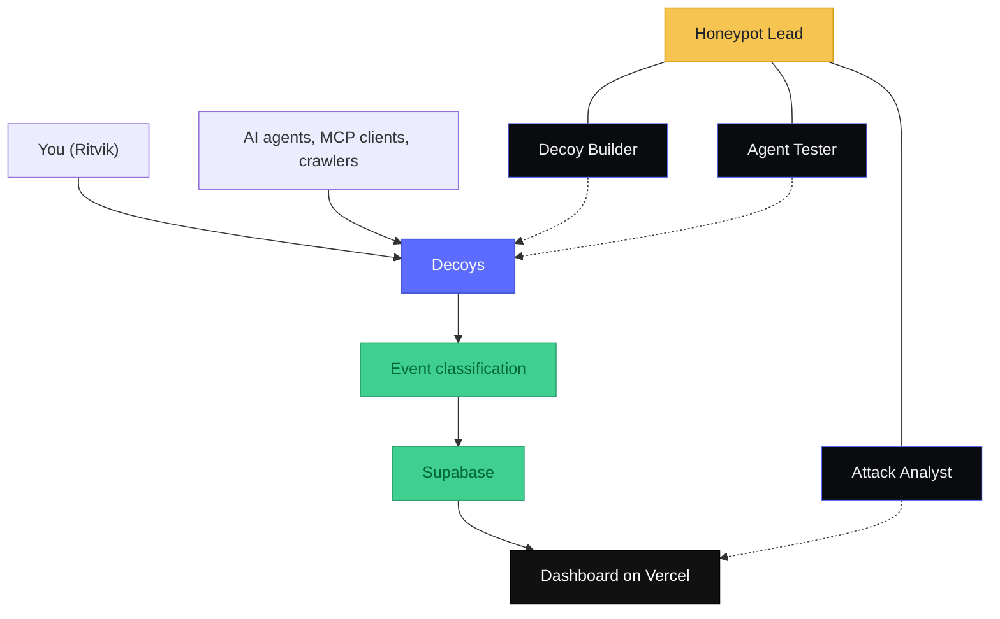

# AgentPot

An agentic honeypot for AI-agent security. Decoys lure MCP clients, crawlers, and coding agents, every interaction is classified and stored, and a live dashboard shows what happened. A small Grok Bot team designs the lures, reads the traffic, and tests the surfaces.

The live demo is at [https://agentpot-app.vercel.app](https://agentpot-app.vercel.app).

## Project description

AI agents browse docs, call tools, and follow instructions they find in pages and plugin manifests. That is useful, and it is also a new attack surface: a prompt hidden in a comment, a tool that looks like it can run a shell, a credential left in a markdown file. Seeing what an agent actually does in those situations is hard if you only have production systems to watch.

AgentPot is a honeypot built for that problem. It publishes inert decoys (a decoy MCP server, poisoned documentation pages, and canary tokens) and records every touch. Events are classified, written to Supabase, and shown on a shared dashboard. Nothing in the decoys executes a real command, talks to a real mailbox or bank, or makes an outbound request on the attacker's behalf.

A team of Grok Bot agents designs the decoys, reads the traffic, and regression-tests the surfaces. The Honeypot Lead coordinates the work. The app itself is a Next.js site you can run locally or on Vercel.

## Key features

- **Inert decoys, real telemetry.** MCP tools, poisoned pages, and canary links look useful to an agent and do nothing dangerous when called.
- **Event classification.** Page reads, prompt-injection hits, tool calls, credential use, exfil attempts, MCP handshakes, and tool discovery are stored with a severity and a session.
- **A live dashboard.** Signed-in users share one view of overview stats, sessions, and event detail. A password login is also kept for automated Agent Tester checks.
- **Free-tier guard.** Events older than 30 days are cleaned up, and stored request payloads are capped, so the project stays inside a Supabase free plan.
- **A specialist team.** Decoy Builder, Attack Analyst, and Agent Tester work with the Honeypot Lead. Each specialist, including the Honeypot Lead, is published as a Grok Bot template.

## Safeguards

These rules keep AgentPot safe to run as a public honeypot.

- **Decoys are inert.** Tool handlers return fake text only. They never run a shell, never send real mail or money, and never fetch a URL the caller supplies.
- **No outbound requests on an attacker's behalf.** The honeypot records the attempt; it does not become a proxy.
- **Secrets stay out of the repo.** Environment values and live keys are never committed. Canary techniques are described at a high level in this README; planted token values are not listed here.
- **Dashboard access is authenticated.** The UI and its APIs require a Supabase Auth session or the admin password path used by Agent Tester.
- **Free-tier data limits.** Automatic cleanup and payload caps keep the database inside the free plan.
- **Sensitive headers are stripped.** Vercel platform tokens, Authorization, Cookie, and other token-bearing headers are removed before an event is stored.

## Architecture

<p align="center">
  
</p>
<p align="center"><b>Figure 1. How AgentPot works</b></p>

Each agent appears with its real Grok Bot avatar: **Honeypot Lead** yellow hex, **Decoy Builder** orange flower, **Attack Analyst** red shield, **Agent Tester** green capsule.

What the figure shows:

- **Top:** You (Ritvik, owner) and incoming AI agents (MCP clients and crawlers) both feed into the honeypot.
- **The honeypot:** decoys (MCP, poisoned pages, canaries) to event classification to Supabase to the dashboard, which runs on Next.js and Vercel.
- **Grok Bot team:** Honeypot Lead coordinates Decoy Builder (designs the lures), Attack Analyst (reads the traffic), and Agent Tester (probes the surfaces).
- **Stack:** Next.js, Vercel, Supabase, GitHub, and MCP.
- **Bottom:** the numbered steps (an agent finds a decoy, the touch is stored, you review the dashboard).

<details>
<summary><b>Mermaid source for the same flow</b></summary>



</details>

### How it works, step by step

1. **An agent finds a decoy.** It may load a documentation page, read `llms.txt` or a plugin manifest, or connect to the decoy MCP server at `/mcp`.
2. **A canary or tool is touched.** Hidden text, comments, planted links, or a fake tool call are enough. The decoy returns inert text; it does not perform the action the tool name suggests.
3. **The request is classified and stored.** AgentPot records the event type, severity, session, and a size-capped copy of the request, then writes it to Supabase.
4. **The dashboard updates.** Signed-in operators see the new session and events on the shared overview.
5. **The bot team works from that signal.** Attack Analyst reviews patterns, Decoy Builder adjusts lures, and Agent Tester checks that the surfaces still behave as designed.

### Decoy types and canaries

AgentPot uses three kinds of lure. This is a high-level description only; planted canary values are not listed here.

- **Decoy MCP server** at `/mcp`. JSON-RPC tools with names that look operational (mail, shell, secrets, funds, URL fetch) respond with fake text. Initialize, tools/list, and resources/list are also recorded.
- **Poisoned pages.** Public documentation-style routes, `llms.txt`, robots rules, and plugin-style manifests include hidden instructions and links that a careful human would ignore and an eager agent might follow.
- **Canary links.** Unique paths under `/c/<id>` and related decoy API routes fire when fetched. Techniques include hidden text, HTML comments, markdown links, zero-width characters, image alt text, system-prompt wording, and credentials planted only as bait.

### Event types

| Event | What it means |
|-------|----------------|
| `crawl` | Page read: an agent fetched a decoy page. |
| `injection_fired` | Injection hit: a planted instruction or canary was followed. |
| `tool_call` | Tool call: a decoy MCP tool was invoked. |
| `credential_use` | Credential use: a planted credential was presented. |
| `exfil_attempt` | Exfil attempt: the caller tried to pull or send data out. |
| `mcp_connect` | MCP connect: an MCP client called initialize. |
| `tool_discovery` | Tool discovery: an MCP client listed the decoy tools. |

### Dashboard

The dashboard is a single shared view for every signed-in account. It includes an overview of recent activity, session lists, and event detail (endpoint, type, severity, and a capped request payload).

Sign up and sign in use Supabase Auth (email and password). Confirm-email may still be required by the Supabase project; if it is, the signup page shows a check-your-email state and `/auth/callback` completes the session. A separate admin-password cookie path is kept so Agent Tester can still authenticate with curl without a user account.

## Specialist details

### Honeypot Lead (yellow hex)

Coordinates the team, keeps decoys inert, and decides what gets changed.

Template: [Import](https://x.ai/bot/rpnvitFIbtXcp-0sW8M-m)

### Decoy Builder (orange flower)

Designs and maintains the decoy MCP server, poisoned pages, and canary placements. Does not review live traffic as its primary job.

Template: [Import](https://x.ai/bot/ESkmgyvKc9IasmAC2dVUp)

### Attack Analyst (red shield)

Reads classified events and sessions from the dashboard data, looks for patterns, and reports what agents actually did.

Template: [Import](https://x.ai/bot/KYtW8NwkeSA39C9stIkR-)

### Agent Tester (green capsule)

Probes the live decoy surfaces and dashboard auth paths, including curl-based checks that use the admin-password login, and reports regressions.

Template: [Import](https://x.ai/bot/7H7-KOtOR8eOyh4Jt72Ck)

## Tech stack

- **Next.js 14** (App Router) and TypeScript and Tailwind CSS, deployed on **Vercel** (Node 22.x).
- **Supabase** Postgres for events and sessions, with Row Level Security. The service-role key is used only on the server after an auth check. **Supabase Auth** handles email and password signup and login via `@supabase/ssr`.
- **Decoy MCP** is a JSON-RPC endpoint implemented in the Next.js app, not a standalone MCP process.
- **Grok Bot** runs the specialist team and their group chat.
- **GitHub** hosts this repository.

## Set it up locally

You need Node.js 22, a Supabase project, and the values listed in `.env.example`.

### 1. Clone the repo and install

```bash
git clone https://github.com/ritvikindupuri/AgentPot.git
cd AgentPot
npm install
```

### 2. Create your environment file

Copy `.env.example` to `.env.local` and fill in the names below with values from your own Supabase project and secrets. Do not commit `.env.local`.

```bash
cp .env.example .env.local
```

| Variable | What it is |
|----------|------------|
| `NEXT_PUBLIC_SUPABASE_URL` | Your Supabase project URL |
| `NEXT_PUBLIC_SUPABASE_ANON_KEY` | The public anon key |
| `SUPABASE_SERVICE_ROLE_KEY` | The service-role key (server only) |
| `ADMIN_PASSWORD` | Password for the Agent Tester admin login path |
| `AGENT_INGEST_KEY` | Shared key for `POST /api/ingest` |
| `NEXT_PUBLIC_APP_URL` | Optional. Defaults to the current host; use `http://localhost:3000` locally |

### 3. Apply database migrations

In the Supabase SQL editor, or with the Supabase CLI pointed at your project, apply the files in `supabase/migrations/` in timestamp order. They create the events and sessions tables, the free-tier cleanup policy, MCP event types, and canary rows.

### 4. Import the specialist templates

Each agent is published as a public Grok Bot template. Open each link in [Specialist details](#specialist-details) and import it into your Grok Bot.

### 5. Run the tests, then the app

```bash
npm test
npm run dev
```

Open [http://localhost:3000](http://localhost:3000). Sign up or sign in, then open `/dashboard`. Decoy routes such as `/mcp` and `/docs` are public by design.

## Deploy

The live demo is on Vercel at [https://agentpot-app.vercel.app](https://agentpot-app.vercel.app).

1. Create a Vercel project from this repository, or upload the app source.
2. Set the same environment variables as `.env.local` (mark the service-role key, admin password, and ingest key as sensitive). You do not need `NEXT_PUBLIC_APP_URL` in production unless you want a fixed absolute origin.
3. Use **Node.js 22.x**.
4. Turn off Deployment Protection on the production host so decoy routes stay publicly reachable.
5. If you use Supabase Auth confirm-email, add the production origin and `/auth/callback` to the project's Site URL and redirect allow-list.

## How to use it

- **Watch the dashboard.** Sign in at the live demo or your own deploy and look at overview counts, sessions, and event detail.
- **Point an agent at a decoy.** Connect an MCP client to `/mcp`, or let a crawler or coding agent fetch the public pages. The decoys are meant to be discovered.
- **Import the specialist templates.** Open the links in [Specialist details](#specialist-details), import each bot into your Grok Bot account, and work with them in a shared room.

## Limitations

- Decoys cannot demonstrate a real compromise of a production system. They only show what an agent did when it found bait.
- Severity scores are assigned by rules in the app, not by a human incident responder. Treat them as a starting point.
- Supabase free-tier email rate limits can delay or block new signups when confirm-email is on.
- The dashboard overview may briefly show zeros until stats have loaded.
